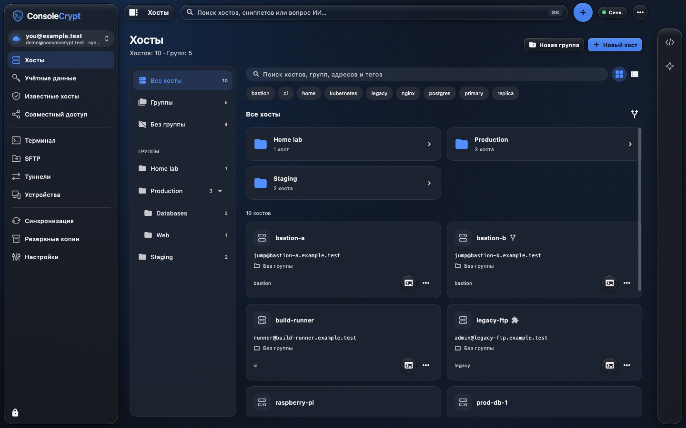

**English** | [Русский](README.ru.md)

<p align="center"></p>

# ConsoleCrypt — clients

An open-source application for working with servers: SSH, RDP, SFTP, Kubernetes, an encrypted
vault for connections and credentials, and collaboration. Work locally, connect
your own sync server, or use the public ConsoleCrypt server.

[Download latest release](https://github.com/evsikovas/consolecrypt-client/releases/latest) ·
[User guide](https://github.com/evsikovas/consolecrypt-docs/blob/main/guide/en.md) ·
[Website](https://consolecrypt.dev/?lang=en) ·
[Server and protocol](https://github.com/evsikovas/consolecrypt-server)



*Hosts and groups in ConsoleCrypt. The screenshot uses demonstration data.*

## Features

- **SSH:** multiple terminal tabs, password and key authentication, host key
  verification, jump hosts, tunnels, and terminal history. Connections go directly
  from your device to the target host.
- **Local terminals:** zsh on macOS; PowerShell, cmd and individual
  WSL distributions on Windows, alongside SSH tabs. [Guide](docs/public/LOCAL_TERMINALS.md).
- **RDP:** Windows remote desktops through IronRDP, parallel session tabs,
  full-screen mode, text clipboard sharing, and redirection of a selected folder
  with separate write permission. Works with a standard Microsoft RDP server;
  you do not need to install IronRDP on the remote Windows machine.
- **Hosts and groups:** saved SSH/RDP connections, credentials, search by name
  or address, and a host picker accessible from the global “+” button.
- **SFTP:** file transfer and preview, editing in an external desktop application,
  and a configurable default editor.
- **Kubernetes:** encrypted connections, live resources, YAML, logs, Pod shells,
  port forwarding, Helm and GitOps, with a native production policy and explicit
  consent for AI context. [Guide](docs/public/KUBERNETES.md).
- **Snippets:** save commands, organize collections, search, edit, and sync them.
- **AI:** explain selected output and errors, and prepare commands. Choose a
  compatible provider, including local models. Actions require confirmation;
  the AI subsystem has no access to the secrets vault.
- **Protected workspace:** an encrypted vault, separate profiles, locking,
  recovery, and encrypted backups.
- **Synchronization:** encrypted data shared between trusted devices;
  the server cannot decrypt vault contents.
- **Selective sharing:** selected SSH and Kubernetes connections, groups, secrets, and snippets,
  with recipient device verification and access management. The chosen server
  must support the corresponding features. Revoking access does not erase copies
  the recipient has already saved.
- **Interface:** light and dark themes, accent colors, terminal palettes,
  side panels, and Russian and English translations.

## Platforms and installation

| Platform | Package | Status |
|---|---|---|
| macOS Intel / Apple Silicon | Universal DMG | Move the application to Applications |
| Windows x64 | EXE / portable ZIP | Run the installer or extract the ZIP |
| Linux x64 | DEB / RPM | Requires a graphical session and an unlocked persistent Secret Service keyring |
| Android ARM64 | APK | Mobile preview, Android 11+ |
| iOS | Previous 0.5.6 Simulator ZIP | New builds and testing deferred; not an iPhone installer |

Compare the downloaded file's SHA-256 with `SHA256SUMS-VERSION.txt` in the release.
Install Linux packages with `sudo apt install ./package.deb` or
`sudo dnf install ./package.rpm`. See the guides below for detailed requirements.
Mobile operating systems restrict background activity; external desktop editors
and RDP folder redirection are unavailable on Android/iOS.
RDP has been tested on macOS and Windows with Windows Server. A Simulator build
does not establish compatibility with a physical iPhone.

RDP supports up to four sessions. The clipboard transfers text up to 64 KiB,
without images or files. Selected-folder transfers support files up to 256 MiB,
with a 512 MiB limit on attempted writes per session. Sharing saved RDP hosts
with other users is not yet supported. To sync RDP hosts, update every device
using the vault to version 0.3 or later.

## Getting started

1. Choose a local profile or connect to a sync server.
2. Create a vault and store the recovery key somewhere safe.
3. In Hosts, add an SSH or RDP connection and fill in the relevant fields.
4. Verify the remote server's identity and connect.
5. If needed, allow RDP clipboard sharing or select a specific shared folder.

SSH/RDP/SFTP traffic does not pass through the sync server. The server handles
accounts and encrypted data, but it can see email addresses and operational
metadata. Do not include secrets in text you choose to send to an AI provider.

Servers in enterprise mode sign accounts in through the organisation's
authorization server (SSO or Active Directory); see the
[Account and sync guide](docs/public/SYNC_ACCOUNT.md).

## Source layout

- `client/flutter/` — shared Flutter interface and platform integrations.
- `client/rust/` — cryptography, storage, sync, SSH/RDP/SFTP, AI, and FFI.
- `crates/models/` — data models used inside the encrypted vault.
- `client/scripts/` — build, packaging, and package verification scripts.
- `docs/public/` — build, release, and troubleshooting guides.

The wire protocol is maintained in the server repository. The client's current
`main` branch pins `cc-protocol` to a specific Git commit; fetching it does not
require building the server application. Historical tags include their matching
protocol copy so published release sources remain self-contained.

## Building

Install Rust through rustup (the version is pinned in `rust-toolchain.toml`),
Flutter, and the native tools for your platform. Exact SDK versions and additional
dependencies are listed in [BUILDING.md](docs/public/BUILDING.md).
The detailed platform build guides are currently in Russian.

```sh
git clone https://github.com/evsikovas/consolecrypt-client.git
cd consolecrypt-client
cd client/flutter
flutter pub get
cd ../..
```

| Platform | Command from the repository root | Guide |
|---|---|---|
| macOS | `bash client/scripts/build-macos.sh --no-cli` | [Building](docs/public/BUILDING.md) |
| Windows | `powershell -File client/scripts/build-windows.ps1` | [Windows](docs/public/BUILD_WINDOWS.md) |
| Linux | `bash client/scripts/build-linux.sh` | [Linux](docs/public/BUILD_LINUX.md) |
| Android | `bash client/scripts/build-android.sh` | [Android](docs/public/BUILDING.md#android--arm64) |
| iOS Simulator | `bash client/scripts/build-ios.sh` | [iOS](docs/public/BUILD_IOS.md) |

Build outputs are placed in `dist/`. macOS/iOS builds require a Mac with Xcode;
Windows builds require MSVC and the Windows SDK. Private signing keys and local
configuration are not included in Git. An APK built with a different Android key
cannot update the installed application in place. Preserve signing identities
and maintain increasing build numbers when preparing updates.

## Testing

```sh
cargo test --locked --manifest-path crates/Cargo.toml
cargo test --locked --manifest-path client/rust/Cargo.toml
cd client/flutter
flutter pub get
flutter analyze
flutter test
```

Tests that need a native library, a system keyring, or a real SSH/RDP server have
additional prerequisites. Do not run Flutter tests alongside a native build
in the same working directory.

## Release 0.9.5

Split terminal panes, a tab column at the left edge and tabs reordered by dragging. The `consolecrypt-cli` command-line client ships with the desktop installers and is installed from Settings → Command line. RDP hosts can be shared with verified colleagues; CSV import and the table designer reach SQLite, Cassandra/ScyllaDB, ClickHouse, MongoDB and Redis; Cassandra/ScyllaDB gets query tracing and every cluster node. Linux copies update themselves from a signed feed; note reminders arrive with the app closed; a custom GGUF model for local AI; SFTP files drag into Finder and Explorer. Team keys are pinned and vouched for by an admin (sync server 0.2.4, protocol 1.12–1.13), and the security review of 26.10.2026 is fixed. See the [0.9.5 notes](docs/public/RELEASE_0_9_5.md).

[Release 0.9.5](https://github.com/evsikovas/consolecrypt-client/releases/tag/v0.9.5) provides six packages for macOS, Windows, Linux and Android; iOS is deferred. Verify downloads against [the SHA-256 manifest](https://github.com/evsikovas/consolecrypt-client/releases/download/v0.9.5/SHA256SUMS-0.9.5.txt).

## Release 0.9.2

New databases: SQLite (local files, or via sqlite3 over SSH, Docker or Kubernetes) and Apache Cassandra / ScyllaDB. A table designer, a result panel with pending row edits and CSV import. The vault key is pinned on each device and colleagues are verified by safety number or QR code before secrets are shared; risky actions can be confirmed with Touch ID, Windows Hello or a fingerprint; copied secrets stay out of clipboard history. Sync server 0.2.2 adds quotas and request limits. See the [0.9.2 notes](docs/public/RELEASE_0_9_2.md).

[Release 0.9.2](https://github.com/evsikovas/consolecrypt-client/releases/tag/v0.9.2) provided six packages for macOS, Windows, Linux and Android; iOS is deferred. Verify downloads against [the SHA-256 manifest](https://github.com/evsikovas/consolecrypt-client/releases/download/v0.9.2/SHA256SUMS-0.9.2.txt).

## Release 0.9.1

Teams: vaults shared by several accounts with roles, a compared member code on join, team colours, policies and key rotation (sync server 0.2.1). Sync servers 0.2.0 and later can admit accounts only through a corporate identity provider (OIDC: Entra ID, AD FS, Keycloak, Google Workspace, Okta) or Active Directory (LDAP); the app names the corporate server and remembers how you signed in, while the vault passphrase still alone opens your data. Notes, tasks and reminders live in the right panel and can be shared. Dangerous actions are confirmed with the vault passphrase; databases get object details, a reusable preview tab and starter snippets; only owners delete shared items (restorable for 30 days); SFTP never runs files that can execute code. See the [0.9.1 notes](docs/public/RELEASE_0_9_1.md).

[Release 0.9.1](https://github.com/evsikovas/consolecrypt-client/releases/tag/v0.9.1) provided six packages for macOS, Windows, Linux and Android; iOS is deferred. Verify downloads against [the SHA-256 manifest](https://github.com/evsikovas/consolecrypt-client/releases/download/v0.9.1/SHA256SUMS-0.9.1.txt).

## Release 0.8.6

Saved database connections can be shared with a colleague's verified device, like hosts and Kubernetes contexts. "Unlock production" allows writes to a production database for 5, 15 or 30 minutes. Cells are edited in the grid by double-click, Run executes the statement on the caret's line, DDL opens as code with Copy, and PostgreSQL never falls back to plaintext on a direct network route. Every new device is reported by e-mail with a "This wasn't me" link, Docker hides secrets beyond environment variables, compose saves are protected against file swaps, and device unlock keys are protected by the system (Touch ID, Windows Hello, fingerprint). Windows: install 0.8.6 once manually, later updates install in place. See the [0.8.6 notes](docs/public/RELEASE_0_8_6.md).

[Release 0.8.6](https://github.com/evsikovas/consolecrypt-client/releases/tag/v0.8.6) provided six packages for macOS, Windows, Linux and Android; iOS is deferred. Verify downloads against [the SHA-256 manifest](https://github.com/evsikovas/consolecrypt-client/releases/download/v0.8.6/SHA256SUMS-0.8.6.txt).

## Release 0.8.5

Databases and Docker are new sections. Databases cover PostgreSQL, MySQL and MariaDB, ClickHouse, Redis and MongoDB: connections live in the encrypted vault and reach the database directly or through an SSH host, jump profile, proxy, saved tunnel, Kubernetes pod forward or Docker container; production connections are read-only. The workspace has a structure tree, an editor with completion, EXPLAIN plan trees, cell editing with an SQL preview, history, snippets and a query assistant that sees schema and rows only with consent. Docker works with the local engine or one on a saved SSH host: compose projects, logs, a container terminal, volumes, port forwards and compose editing behind the vault passphrase. Kubernetes pods with standard database ports get a "Connect to database" button. See the [0.8.5 notes](docs/public/RELEASE_0_8_5.md).

[Release 0.8.5](https://github.com/evsikovas/consolecrypt-client/releases/tag/v0.8.5) provided six packages for macOS, Windows, Linux and Android; iOS is deferred. Verify downloads against [the SHA-256 manifest](https://github.com/evsikovas/consolecrypt-client/releases/download/v0.8.5/SHA256SUMS-0.8.5.txt).

## Release 0.6.4

Kubernetes on desktop is redesigned: a navigator with collapsible resource groups, a live cluster overview with an optional basic metrics-server, object details over the table, the cluster AI and port forwards in the right panel, and clearer YAML refusals. Terminal tabs gain a context menu, activity highlighting and font choice; hosts can be imported from ~/.ssh/config, shortcuts can be remapped and AI answers render Markdown. See the [0.6.4 notes](docs/public/RELEASE_0_6_4.md).

[Release 0.6.4](https://github.com/evsikovas/consolecrypt-client/releases/tag/v0.6.4) provided six packages for macOS, Windows, Linux and Android; iOS is deferred. Verify downloads against [the SHA-256 manifest](https://github.com/evsikovas/consolecrypt-client/releases/download/v0.6.4/SHA256SUMS-0.6.4.txt).

## Release 0.6.3

Kubernetes becomes a dedicated workspace: encrypted kubeconfig import and sync, live resources, reviewed YAML, logs, Pod shell, port forwarding, Helm, GitOps and cluster-aware AI. See the [0.6.3 notes](docs/public/RELEASE_0_6_3.md) and the [Kubernetes guide](docs/public/KUBERNETES.md).

[Release 0.6.3](https://github.com/evsikovas/consolecrypt-client/releases/tag/v0.6.3) provided six packages for macOS, Windows, Linux and Android; iOS is deferred. Verify downloads against [the SHA-256 manifest](https://github.com/evsikovas/consolecrypt-client/releases/download/v0.6.3/SHA256SUMS-0.6.3.txt).

## Release 0.5.6

Recovery Kit words stay readable on phones and with larger text; the QR code moves below the words when needed. See the [0.5.6 notes](docs/public/RELEASE_0_5_6.md).

[Release 0.5.6](https://github.com/evsikovas/consolecrypt-client/releases/tag/v0.5.6) provided seven packages for macOS, Windows, Linux, Android and iOS Simulator. Verify downloads against [the SHA-256 manifest](https://github.com/evsikovas/consolecrypt-client/releases/download/v0.5.6/SHA256SUMS-0.5.6.txt).

## Mobile RDP and desktop improvements

Phone RDP opens fullscreen with touchpad gestures, a floating menu and an overlay keyboard. Desktop adds known_hosts import, a New local terminal palette action and corrected macOS window-button spacing. See the [0.5.5 notes](docs/public/RELEASE_0_5_5.md).

## Release 0.5.2

The 0.5 series adds local terminals and a three-model local AI catalog, while
preserving verified model downloads and device preferences across updates.
Local AI/snippet commands support insertion without Enter; ordinary local
terminal input remains interactive. See the [0.5 notes](docs/public/RELEASE_0_5_2.md),
[local terminals](docs/public/LOCAL_TERMINALS.md) and [local AI](docs/public/LOCAL_AI.md).

## Release 0.4.1

Version 0.4.1 adds a phone RDP touchpad and an installable local AI model on
Windows/macOS. The model stays on this device and can become the default provider.
Native packages build only from version tags on `main`. See the
[release notes](docs/public/RELEASE_0_4_1.md), [local AI guide](docs/public/LOCAL_AI.md)
and [release workflow](docs/public/GITHUB_ACTIONS.md).

## Release 0.3.2 and the GitHub migration

Version 0.3.2 moves builds to GitHub Actions and updates website, source and
signed update-feed addresses to consolecrypt.dev. See the
[release notes](docs/public/RELEASE_0_3_2.md) and [release workflow](docs/public/GITHUB_ACTIONS.md).
Existing profiles retain their saved server addresses and trust pins; do not
recreate your vault or change a working profile's URL to follow this migration.

Known limitation: changing a shared folder or its permissions during an RDP
session can sometimes disconnect it. Save remote work before making changes
and reconnect if necessary. [Migration details](MIGRATION.md).

## License and issue reporting

Current first-party code is licensed under [AGPL-3.0-only](LICENSE). Third-party
components retain their own licenses and notices; historical releases retain
their original terms. Author: Alexander Evsikov. Report vulnerabilities as
described in [SECURITY.md](SECURITY.md), and other reproducible problems through
Issues. Do not attach passwords, private keys, tokens, or real vault contents.
