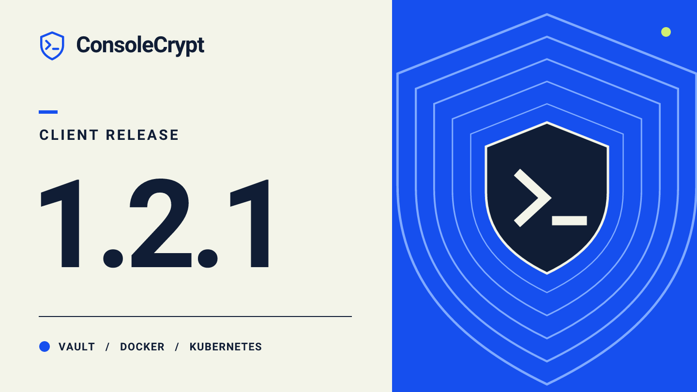

# ConsoleCrypt 1.2.1

## Русский

В разделе «Пароли» теперь можно работать с HashiCorp Vault и OpenBao. В Docker появился экспериментальный мастер переноса контейнера в Kubernetes.

- **Vault и OpenBao.** Войдите по токену или логину и паролю, откройте каталог KV v1 или v2 и скопируйте нужное значение. Это можно сделать и из палитры команд. Сохранённые подключения синхронизируются через личное зашифрованное хранилище. Для каждого подключения вы выбираете, передавать ли пароль или токен на другие устройства. Биометрический вход настраивается отдельно на каждом устройстве.
- **KDBX.** Импортируйте и экспортируйте записи пачкой в CSV или JSON. JSON также сохраняет пользовательские поля. Оба формата содержат пароли открытым текстом. В списке пяти недавних источников теперь рядом с локальными и WebDAV-базами появляются Vault и OpenBao.
- **Docker.** Выбирайте локальные движки на Windows, macOS и Linux или подключайтесь к Docker по SSH. На Windows также доступно рабочее пространство WSL Containers. Длинные списки портов разбиты на страницы по 20. При удалении контейнера можно отдельно выбрать его тома и сети. По умолчанию они сохраняются, а ресурсы, используемые другими контейнерами, защищены.
- **Docker → Kubernetes · Экспериментально.** Выберите контейнер Linux без постоянных томов и опубликованный образ, доступный кластеру. Мастер проверяет digest перед автоподстановкой и переносит команду запуска с аргументами. Проверьте шаблон или черновик ИИ, выполните серверную проверку и подтвердите создание Deployment с одной репликой и внутреннего Service. При сбое видны образ, причина и число перезапусков.
- **SSH и туннели.** При подключении к Linux через встроенный SSH-клиент мониторинг показывает загрузку CPU, памяти и диска, а также скорость сети. Замеры продолжаются, пока сессия открыта, даже если панель свёрнута. Исправлено восстановление сохранённых пробросов портов Docker и Kubernetes.
- **Терминал и macOS.** Исправлена многострочная вставка в локальный PowerShell. В новом синем DMG приложения ConsoleCrypt и ConsoleCrypt Terminal стоят в один ряд с папкой Applications. Перетащите туда нужное приложение или оба.

[Руководство со скриншотами](https://github.com/evsikovas/consolecrypt-docs/blob/main/guide/ru.md)

## English

Passwords now opens HashiCorp Vault and OpenBao. Docker adds an experimental wizard for deploying a container to Kubernetes.

- **Vault and OpenBao.** Sign in with a token or a username and password, browse KV v1 or v2 folders, and copy a value. You can also do this from the command palette. Saved connections sync through your encrypted personal vault. For each connection, choose whether to sync its password or token. Set up biometric sign-in on each device.
- **KDBX.** Import and export entries in bulk as CSV or JSON. JSON also preserves custom fields. Both formats contain plaintext passwords. The five most recent sources now include Vault and OpenBao alongside local and WebDAV databases.
- **Docker.** Choose a local engine on Windows, macOS, or Linux, or connect to Docker over SSH. Windows also has a WSL Containers workspace. Long port lists show 20 ports per page. When removing a container, choose which volumes and networks to remove with it. They are kept by default, and resources used by other containers are protected.
- **Docker → Kubernetes · Experimental.** Select a Linux container without persistent mounts and a published image your cluster can pull. The wizard verifies the digest before filling in the image and preserves the startup command and arguments. Review a template or AI draft, run a server-side dry run, and confirm creation of a single-replica Deployment and an internal Service. If a Pod fails, you can see the image, reason, and restart count.
- **SSH and tunnels.** When connected to Linux through the built-in SSH client, view CPU, memory and disk usage and network throughput. Sampling continues while the session is open, even with the panel collapsed. Restoring saved Docker and Kubernetes port forwards has been fixed.
- **Terminal and macOS.** Multiline paste in local PowerShell has been fixed. In the new blue DMG, ConsoleCrypt and ConsoleCrypt Terminal sit in a row with the Applications folder. Drag either app or both into the folder.

[Illustrated guide](https://github.com/evsikovas/consolecrypt-docs/blob/main/guide/en.md)

## Español

Ahora puedes abrir HashiCorp Vault y OpenBao desde Contraseñas. Docker incorpora un asistente experimental para desplegar un contenedor en Kubernetes.

- **Vault y OpenBao.** Accede con un token o con usuario y contraseña, navega por las carpetas de KV v1 o v2 y copia el valor que necesites. También puedes hacerlo desde la paleta de comandos. Las conexiones guardadas se sincronizan a través de tu bóveda personal cifrada. Para cada conexión, eliges si quieres sincronizar la contraseña o el token. El acceso biométrico se configura en cada dispositivo.
- **KDBX.** Importa y exporta entradas en lote en CSV o JSON. JSON conserva también los campos personalizados. Ambos formatos contienen las contraseñas en texto plano. La lista de las cinco fuentes recientes ahora incluye Vault y OpenBao junto a las bases locales y de WebDAV.
- **Docker.** Elige un motor local en Windows, macOS o Linux, o conéctate a Docker por SSH. En Windows también puedes abrir el espacio de trabajo WSL Containers. Las listas largas muestran 20 puertos por página. Al eliminar un contenedor, puedes elegir qué volúmenes y redes eliminar con él. Por defecto se conservan. Los recursos que usan otros contenedores están protegidos.
- **Docker → Kubernetes · Experimental.** Selecciona un contenedor Linux sin montajes persistentes y una imagen publicada que el clúster pueda descargar. El asistente comprueba el digest antes de rellenar el campo de imagen y conserva el comando de inicio y sus argumentos. Revisa la plantilla o el borrador generado con IA, valida los recursos en el servidor y confirma la creación de un Deployment de una réplica y un Service interno. Si un Pod falla, puedes ver la imagen, el motivo y el número de reinicios.
- **SSH y túneles.** Al conectarte a Linux con el cliente SSH integrado, puedes consultar el uso de CPU, memoria y disco, y la velocidad de la red. Las mediciones continúan mientras la sesión esté abierta, incluso con el panel contraído. Se ha corregido la restauración de los reenvíos de puertos guardados de Docker y Kubernetes.
- **Terminal y macOS.** Se ha corregido el pegado de varias líneas en PowerShell local. En el nuevo DMG azul, ConsoleCrypt y ConsoleCrypt Terminal aparecen en la misma fila que la carpeta Aplicaciones. Arrastra a la carpeta la aplicación que quieras instalar o ambas.

[Guía con capturas de pantalla](https://github.com/evsikovas/consolecrypt-docs/blob/main/guide/es.md)

## 简体中文

现在可以在「密码」中打开 HashiCorp Vault 和 OpenBao。Docker 新增了将容器部署到 Kubernetes 的实验性向导。

- **Vault 和 OpenBao。** 使用令牌或用户名和密码登录，浏览 KV v1 或 v2 目录并复制所需的值。这些操作也可以在命令面板里完成。保存的连接通过加密的个人保险库同步。每个连接都可单独选择是否同步密码或令牌。生物识别登录需在各设备上分别设置。
- **KDBX。** 支持通过 CSV 或 JSON 批量导入、导出条目。JSON 还能保留自定义字段。两种格式均以明文保存密码。最近使用的五个来源现在可包含本地数据库、WebDAV 数据库、Vault 和 OpenBao。
- **Docker。** 可选择 Windows、macOS 或 Linux 上的本地引擎，也可通过 SSH 连接远程 Docker。Windows 用户还可打开 WSL Containers 工作区。较长的端口列表每页显示 20 项。删除容器时，可单独选择要一并删除的卷和网络，默认全部保留。其他容器正在使用的资源会受到保护。
- **Docker → Kubernetes（实验性）。** 选择没有持久化挂载的 Linux 容器和集群可以拉取的已发布镜像。向导会先验证镜像摘要，再自动填入镜像地址，并保留启动命令及其参数。可以审阅模板或 AI 草稿，在服务器上试运行，然后确认创建单副本 Deployment 和集群内部的 Service。如果 Pod 启动失败，可以查看镜像、原因和重启次数。
- **SSH 和隧道。** 使用内置 SSH 客户端连接 Linux 主机后，可查看 CPU、内存、磁盘使用率以及网络吞吐量。只要会话保持打开，即使收起面板也会继续采样。修复了恢复已保存的 Docker 和 Kubernetes 端口转发时的问题。
- **终端和 macOS。** 修复了本地 PowerShell 中的多行粘贴。新版蓝色 DMG 将 ConsoleCrypt、ConsoleCrypt Terminal 和「应用程序」文件夹排列在同一行。可将任一应用或两个应用一起拖入文件夹安装。

[图文指南](https://github.com/evsikovas/consolecrypt-docs/blob/main/guide/zh.md)
