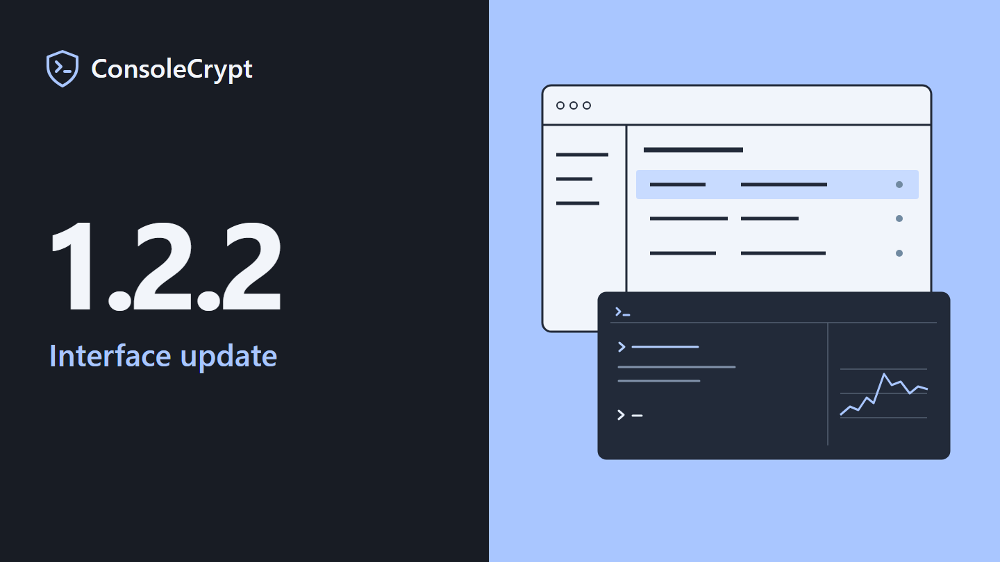

# ConsoleCrypt 1.2.2

## Русский

Обновление большей части интерфейса приложения.

- **Хосты.** По кнопке сведений под списком открывается карточка подключения. Адрес, имя пользователя, порт и группа разнесены по колонкам. В узком окне кнопки переходят на следующую строку.
- **Пароли.** В открытой базе KeePass группы, список записей и поля выбранной записи занимают отдельные панели. В палитре команд для KeePass, Vault и OpenBao стрелки выбирают поле, а Enter копирует его. Значения в палитре скрыты.
- **Терминал.** У загрузки CPU появился график за последние пять минут. Рядом видны память, диск и скорость сети. Режим Terminal Only запоминает настройки оформления на устройстве и сохраняет компактную панель команд при вкладках слева.
- **Docker и Kubernetes.** Ширину панели контейнера можно менять перетаскиванием. В меню Compose можно удалить весь проект и выбрать связанные ресурсы для очистки. В журнале Pod фильтры, кнопки и строки вывода получили отдельное место.
- **Туннели, устройства и синхронизация.** SSH-туннели отделены от пробросов Docker и Kubernetes. Доверенные устройства и запросы на подключение собраны в отдельных списках. Экран синхронизации показывает состояние хранилища и очередь исходящих изменений.

## English

This release refreshes most of the application interface.

- **Hosts.** Open a host’s details below the list. Its address, username, port and group have separate columns. Actions wrap when the window narrows.
- **Passwords.** KeePass groups, entries and the selected entry’s fields have their own panes. In the KeePass, Vault and OpenBao command palette, use the arrow keys to select a masked field and Enter to copy it.
- **Terminal.** View the last five minutes of CPU usage alongside memory, disk and network metrics. Terminal Only remembers appearance settings on this device and keeps the toolbar compact when tabs are on the left.
- **Docker and Kubernetes.** Drag the divider to resize container details. Remove a Compose project from its menu and choose which associated resources to clean up. Pod logs have separate areas for filters, controls and output.
- **Tunnels, devices and sync.** SSH tunnels and container port forwards have separate tables. Trusted devices and requests are listed separately. Sync shows vault status and the outgoing queue.

## Español

Esta versión renueva la mayor parte de la interfaz de la aplicación.

- **Hosts y contraseñas.** Los datos del host aparecen debajo de la lista y los botones pasan a otra fila cuando falta espacio. KeePass separa grupos, entradas y campos. En la paleta de KeePass, Vault y OpenBao, usa las flechas para elegir un campo oculto e Intro para copiarlo.
- **Terminal.** Consulta los últimos cinco minutos de uso de CPU junto a la memoria, el disco y la red. Terminal Only recuerda la apariencia en este dispositivo y mantiene compacta la barra al colocar las pestañas a la izquierda.
- **Docker y Kubernetes.** Arrastra el separador para ampliar los detalles del contenedor. Desde el menú de Compose puedes eliminar el proyecto y elegir qué recursos asociados quieres borrar. Los filtros y controles de los registros de Pods tienen su propio espacio.
- **Túneles, dispositivos y sincronización.** Los túneles SSH y los reenvíos de contenedores tienen tablas separadas. Los dispositivos de confianza y las solicitudes aparecen en listas distintas. La pantalla de sincronización muestra el estado de la bóveda y los cambios pendientes de envío.

## 简体中文

本次更新重新设计了应用的大部分界面。

- **主机和密码。** 点击主机的信息按钮即可在列表下方查看地址、用户名、端口和分组。窗口变窄时，操作按钮会自动换行。KeePass 分栏显示分组、条目和字段。在 KeePass、Vault 和 OpenBao 命令面板中，可用方向键选择字段，按 Enter 复制。字段值默认隐藏。
- **终端。** CPU 图表显示最近五分钟的负载，旁边列出内存、磁盘和网络指标。Terminal Only 会在本机保存外观设置。标签页放在左侧时，工具栏仍然紧凑。
- **Docker 和 Kubernetes。** 拖动分隔线即可调整容器详情面板的宽度。在 Compose 菜单中可删除整个项目，并选择要清理的关联资源。Pod 日志的筛选条件、操作按钮和输出区域已分开显示。
- **隧道、设备和同步。** SSH 隧道与容器端口转发分表显示。受信任设备和接入请求分别列出。同步页面显示保险库状态及待发送的更改。
