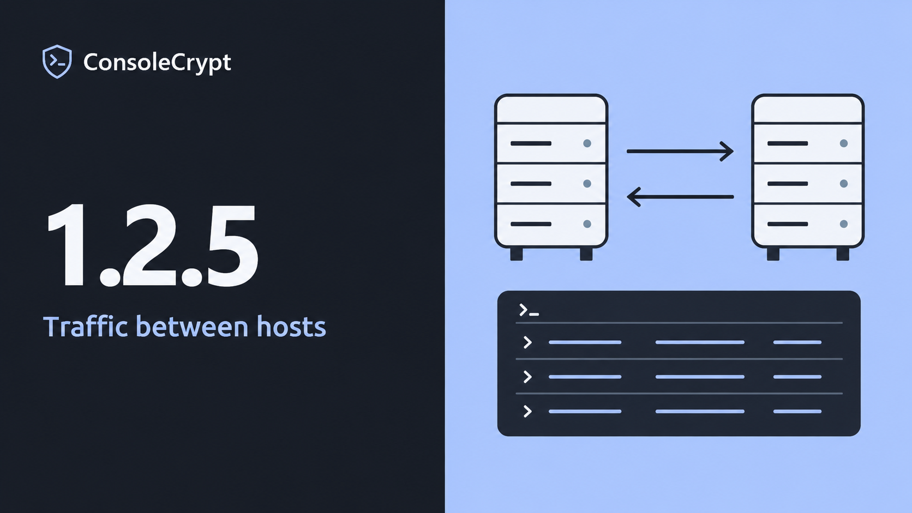

# ConsoleCrypt 1.2.5

## Русский

Теперь в TCPdump можно посмотреть трафик между двумя хостами в реальном времени. Выберите сервер захвата и второй узел, откройте пакет и посмотрите его направление, протокол, порты и доступные байты. Стрелка меняет серверы местами.

- **SSH и tmux.** Панель активного SSH-соединения показывает сессии tmux. Можно создать сессию, подключиться, переключиться или отсоединиться и вернуться к работе позже.
- **Терминал.** Поиск работает в активной панели, в том числе в Terminal Only. Можно сменить кодировку, выбрать показатели и цвета нижней строки, открыть историю оболочки сервера. Группировка вкладок находится в настройках терминала, разрешение многострочной вставки без подтверждения — в разделе «Безопасность».
- **Docker.** В карточках образов и сетей видны подробности, во вкладках диска и событий — занятое место и недавние действия контейнеров. В инспекторе компактнее отображаются ресурсы, процессы, логи и JSON.
- **Из Docker в Kubernetes.** Выберите сохранённый реестр или добавьте его в мастере. Опубликуйте готовый образ либо соберите проект из папки с Dockerfile через Buildx для Linux amd64, arm64 или обеих платформ. Сборка доступна на компьютере и на SSH-сервере. Полученный адрес образа подставляется в мастер. Для Deployment и Service можно выбрать шаблон или отредактировать запрос к ИИ, затем проверить YAML на сервере.
- **Android.** В широком окне на планшете или внешнем экране доступны боковая навигация и рабочие панели, как на компьютере. При уменьшении окна возвращается компактный интерфейс.
- **Пароли и чат.** Недавние KDBX, подключения WebDAV и Vault / OpenBao собраны по группам. Для переписки с ИИ стало больше места.

## English

Watch live traffic between two hosts with TCPdump. Choose the capture server and its peer, then open a packet to inspect its direction, protocol, ports and available bytes. Use the arrow to swap hosts.

- **SSH and tmux.** The active SSH connection lists tmux sessions. Create, attach, switch or detach and return to a session later.
- **Terminal.** Search the active pane, including in Terminal Only. Switch encodings, choose metrics and colors for the status bar, or browse the remote shell’s history. Tab grouping lives in Terminal settings. Security settings control confirmation for multiline paste.
- **Docker.** Inspect images and networks in cards. Disk usage shows where space goes, and events show recent container activity. Container resources, processes, logs and JSON use a more compact layout.
- **Docker to Kubernetes.** Select a saved registry or add one in the wizard. Publish an existing image or build from a directory containing a Dockerfile with Buildx for Linux amd64, arm64 or both. Build on your computer or on an SSH host. The published reference fills the image field. Use the template or edit the AI prompt for a Deployment and Service, then validate the YAML on the server.
- **Android.** Wide tablet and external-display windows gain desktop-style navigation and workspace panes. Narrowing the window restores the compact layout.
- **Passwords and chat.** Recent KDBX files, WebDAV connections and Vault / OpenBao connections have separate groups. The AI conversation has more room.

## Español

Consulta el tráfico entre dos hosts en tiempo real con TCPdump. Elige el servidor que hará la captura y el otro extremo. Abre un paquete para ver su dirección, protocolo, puertos y bytes disponibles. La flecha intercambia los hosts.

- **SSH y tmux.** La conexión SSH activa muestra las sesiones tmux. Puedes crear una sesión, conectarte, cambiar de sesión o desconectarte y volver más tarde.
- **Terminal.** Busca texto en el panel activo, también en Terminal Only. Cambia la codificación, elige los indicadores y colores de la barra inferior o consulta el historial del shell remoto. La agrupación de pestañas está en los ajustes del terminal y la confirmación del pegado multilínea, en Seguridad.
- **Docker.** Las imágenes y redes tienen fichas de detalle. Consulta el espacio en disco y los eventos recientes de los contenedores. Los recursos, procesos, registros y datos JSON ocupan menos espacio.
- **De Docker a Kubernetes.** Elige un registro guardado o añade uno en el asistente. Publica una imagen existente o compílala desde una carpeta con Dockerfile mediante Buildx para Linux amd64, arm64 o ambas. Puedes compilar en tu equipo o en un servidor SSH. El asistente rellena la referencia publicada. Usa la plantilla o edita la petición a la IA para generar el Deployment y el Service. Después, valida el YAML en el servidor.
- **Android.** Las ventanas anchas en tabletas y pantallas externas muestran navegación lateral y paneles de escritorio. Al reducir la ventana se recupera la vista compacta.
- **Contraseñas y chat.** Los archivos KDBX recientes y las conexiones WebDAV y Vault / OpenBao aparecen en grupos separados. El chat con la IA tiene más espacio.

## 简体中文

使用 TCPdump 实时查看两台主机之间的流量。选择抓包服务器和对端，打开数据包即可查看方向、协议、端口和已捕获的字节。点击箭头可以互换两台主机。

- **SSH 与 tmux。** 在当前 SSH 连接中查看 tmux 会话。可以新建、连接或切换会话，也可以分离会话，稍后再回来继续工作。
- **终端。** 在当前窗格内搜索文本，Terminal Only 也支持搜索。可切换字符编码、自定义底部状态栏的指标与颜色，并查看远程 shell 的历史记录。标签页分组位于终端设置中，多行粘贴确认位于安全设置中。
- **Docker。** 在卡片中查看镜像与网络详情，在磁盘用量和事件页查看空间占用及容器近期活动。容器资源、进程、日志和 JSON 的显示更加紧凑。
- **从 Docker 到 Kubernetes。** 在向导中选择已保存的镜像仓库或添加新仓库。可直接推送已有镜像，也可用 Buildx 从含 Dockerfile 的目录构建 Linux amd64、arm64 或双架构镜像。构建可在本机或 SSH 服务器上执行。发布后的镜像地址会自动填入向导。可使用模板，或编辑 AI 提示词来生成 Deployment 和 Service，然后在服务器上验证 YAML。
- **Android。** 在平板或外接显示器上拉宽窗口，即可使用桌面式侧边导航和工作窗格。缩窄窗口可切回紧凑布局。
- **密码与聊天。** 最近打开的 KDBX 文件、WebDAV 连接和 Vault / OpenBao 连接分别列出。AI 对话区也有了更多空间。
